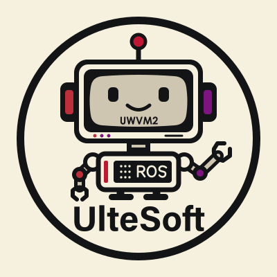

<div align="center">
  
  <br/>
  <h1>UlteSoft WebAssembly Virtual Machine 2 for ROS</h1>
  <p>
    
    
  </p>
</div>

<div style="text-align:center">
    <a href="https://github.com/UlteSoft/uwvm2/actions?query=workflow%3ACI">
        
    </a>
    <a href="LICENSE.md">
        
    </a>
    <a href="https://en.cppreference.com">
        
    </a>
</div>

## Introduction
UlteSoft WebAssembly Virtual Machine 2 for ROS

## Features
### WASM Feature Extensions
Most wasm standards are supported. See [feature.md](documents/features.md). For detailed changes in each WebAssembly release, see [wasm-release.md](documents/wasm-release.md).

### Supports multiple platforms
The ROS product admits Linux GNU builds for x86_64, i686, AArch64, ARMv7 soft-float (arm) and ARMv7 hard-float (armhf). The broader upstream platform sources are retained, but they are not additional supported ROS deployment targets. LLVM full-module execution is required; the interpreter is an optional execution backend. See the [product build policy](xmake/utility/ros_product.lua) and [operator whitepaper](documents/user-whitepaper.md).

### Runtime execution backends
UWVM2 retains two explicit runtime backends: the full-translation interpreter and full-module LLVM AOT. See [runtime compiler documentation](src/uwvm2/runtime/compiler/readme.md). For the u2 interpreter (“register-ring stack-top cache”) architecture, see [u2 interpreter documentation](src/uwvm2/runtime/compiler/uwvm_int/readme.md).

The ROS LLVM backend builds its own pinned **LLVM 23.1.1 stable release** with
the downstream MIPS R6 repair. It does not use system LLVM, `LLVM_CONFIG`, or
an `llvm-config` executable; dependency information comes directly from CMake.
The first LLVM-enabled xmake configuration needs CMake and Ninja; see
[bundled LLVM provenance and build instructions](third-parties/llvm/README.md).
The [maintenance rationale](documents/toolchain/ros-llvm-maintenance.md) explains
the version, FP, ABI, module and cache constraints; the
[verification record](documents/toolchain/ros-bundled-llvm23.md) distinguishes
completed test snapshots from remaining platform/build coverage.

### High-performance, secure, and highly scalable standard parser
High-performance, spec-compliant WebAssembly binary parser built on concept-oriented C++26 with SIMD-aware design and extensive fuzzing for safety and robustness. See [readme.md](src/uwvm2/parser/readme.md) for details.

### WASI host extensions
WASI Preview 1 implementations for memory32 and memory64 are compiled into the ROS product. Each module starts with no exposed WASI imports and no host authority. Explicit Single or Group policies separately enable the namespace, select each interface's hidden/deny/allow state, and grant operations and resources. Socket implementations are present but convey no default rights. See [WASI commands](documents/command-line/wasi.md) and [host permissions](documents/command-line/host-permissions.md).

### Plugin-facing host APIs
Preload modules (dynamic libraries / weak-symbol plugins) can consume a stable host-side API for linear-memory access, and can optionally consume the UWVM2 WASI Preview 1 host API as well. The WASI table is disabled by default and must be explicitly enabled from the command line. When enabled for a single target or named group, plugin-facing WASI calls are resolved against that target's WASI environment rather than one process-wide table. Native dynamic libraries still execute as host code and must be treated as trusted host extensions.

### ROS 1 and ROS 2 runtime extensions
ROS 1 and ROS 2 host interfaces are mandatory build components, with no default guest exposure or authority. They use separately configured native Gateways. Each Wasm instance receives its explicit policy for Topic, Service, Parameter, Graph, Action, TF, Time, Logging and ROS 2 Lifecycle access; enabling a namespace alone grants none of these operations. The core build requires no ROS libraries. See the [ROS 1 CLI](documents/command-line/ros1.md), [ROS 2 CLI](documents/command-line/ros2.md) and [numbered ROS test suites](test/0073.ros-tests).

The [uwvm2-ros SDK](https://github.com/UlteSoft/uwvm2-ros-sdk) is maintained
in a separate MIT-licensed repository. It provides language bindings, platform
SDKs, Xmake examples, bilingual manuals and precompiled development inputs
distributed with Git LFS. This repository provides the underlying virtual
machine. See the SDK review documents for qualified language and platform
scopes. SDK construction grants no ROS authority.

See the [platform SDK build and test guide](documents/how-to-build/ros-platform-sdk.md)
for explicit vendor selections, source-only imports and numbered test entry points.

### Flexible linear memory models
uwvm2 provides three host-side models for implementing WebAssembly linear memory (mmap-based, multi-threaded allocator-based, and single-thread allocator-based backends), allowing efficient execution on platforms with or without virtual memory support. See [readme.md](src/uwvm2/object/memory/readme.md) for a detailed description.

The executable and Xmake target are named `uwvm2-ros` to allow installation alongside upstream uwvm2. Build with `xmake build uwvm2-ros` and run with `xmake run uwvm2-ros --version`.

## Commandline interface
* Get version information
```bash
$ uwvm2-ros --version
```
* Get a list of commands
```bash
$ uwvm2-ros --help
```
* Running uwvm2 virtual machine
```bash
$ uwvm2-ros <param0> <param1> ... --run <wasm:path> <argv1:str> <argv2:str> ...
$ uwvm2-ros <param0> <param1> ... <wasm:path> <argv1:str> <argv2:str> ...
```
When `--run`, `-r`, or `--` is omitted, trailing plain arguments are treated as the Wasm path and guest argv.
* Configure WASI permissions and preopened directories using the explicit
  [WASI policy guide](documents/command-line/wasi.md). Namespace admission,
  per-interface exposure, operation grants and descriptor rights are separate.
  The removed `--wasip1-mount-dir` spelling is not accepted by this product.

## How to build

Start with the [Linux ROS build guide](documents/how-to-build/linux.md), the
[Xmake option reference](documents/xmake-options.md) and the
[operator whitepaper](documents/user-whitepaper.md). The build rejects non-Linux
ROS targets and attempts to remove required WASI, ROS or socket interfaces.
Upstream platform guides describe retained source portability, not additional
qualified ROS products.

## Releases
* [Dev](https://github.com/UlteSoft/uwvm2/tree/master): branch `master`
* [Release V2.0.2.1](https://github.com/UlteSoft/uwvm2/tree/V2.0.2): branch `V2.0.2`
* [Beta V2.0.1.1](https://github.com/UlteSoft/uwvm2/tree/V2.0.1): branch `V2.0.1`

## Support / Donations

If you find this project useful, you can support its development with a crypto donation. See [donations.md](donations.md)
